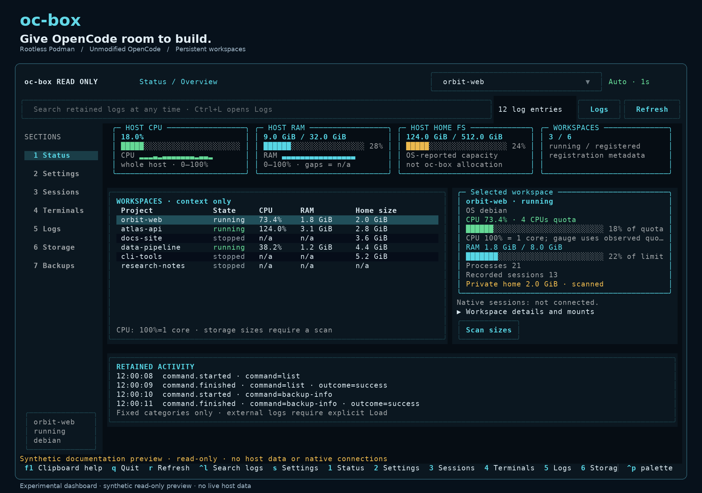

# oc-box

**Persistent rootless Podman development environments for unmodified OpenCode.**

Give OpenCode its own Linux environment for tools, packages and services while
mounting only your selected project by default. Keep the environment and
conversations between visits, without patching OpenCode or replacing its tools.

**The main documentation targets OpenCode 2.x.** OpenCode 1.x remains supported
as [legacy, with its own guide](docs/legacy/README.md).

[Get started](#quick-start) · [OpenCode 2.x docs](docs/README.md) ·
[Legacy 1.x](docs/legacy/README.md) ·
[Command reference](docs/cli.md) · [Security](SECURITY.md) ·
[Contributing](CONTRIBUTING.md)

> **Release channels:** stable is the default. The optional dashboard, host-file
> workflows and other 1.7 development features require explicit opt-in. A merged
> feature is not necessarily in a published package.
> [Choose a channel](docs/update-channels.md) ·
> [Development features and limitations](docs/releases/1.7.md)

<!-- readme-hero -->


*The experimental OpenCode 2.x dashboard, captured from the real interface with synthetic
read-only sample data. [Read the TUI guide](docs/tui.md#tui-guide).*

<!-- /readme-hero -->

## Why oc-box?

- **A persistent development machine per project.** Install compilers, SDKs,
  databases and distro packages inside the container.
- **Native OpenCode integrations.** MCP servers, formatters and plugins run
  alongside OpenCode. See the [2.x capability reference](docs/opencode-2.md) for
  version-specific limits.
- **Your choice of Linux.** Tumbleweed, Leap, Ubuntu, Debian, Fedora, Arch or Alpine.
- **Continuity without starting over.** Resume conversations, import host history
  and rebuild the container OS while keeping the project and private home.
- **Explicit resource and hardware choices.** Set CPU/RAM/process ceilings and
  opt in to device access.

Rootless containers are **not virtual machines**: they share the host kernel,
and your mounted project is writable. Read the [trust boundary](SECURITY.md)
before using oc-box with sensitive projects.

<a id="requirements-and-installation"></a>
<a id="install-from-pypi"></a>
<a id="install-from-github-or-source"></a>
<a id="github-installation-layout"></a>

## Quick start

Run these commands on the **Linux host as your regular user**, not inside
oc-box and not with sudo.

### 1. Install

You need Python 3.10+, host OpenCode **2.x**, Git, curl, rootless Podman with pasta
networking and delegated CPU/memory/process cgroup controllers. Initial setup
needs network access. See [installation and prerequisites](docs/installation.md)
for all methods.

**First installation — recommended GitHub path with vault and TUI:**

```sh
curl -fsSL --proto '=https' --tlsv1.2 https://raw.githubusercontent.com/groopcd/oc-box/master/install.sh | sh -s -- --devel --with-vault --with-tui
oc-box --version
oc-box doctor
```

This explicitly selects a **published development release**, because stable
does not yet include the dashboard. Dependencies stay private to the GitHub
installation. This does not initialize or unlock a vault, change credential
policy, launch the dashboard or start a workspace. The command downloads and
runs the public installer; review it first if preferred.

**Already installed?** Use the existing installation, without rerunning curl:

```sh
oc-box upgrade --devel --vault --tui  # Add both extras and select development
# Or request either extra independently:
oc-box upgrade --devel --vault
oc-box upgrade --devel --tui
```

These upgrade flags require a launcher release that supports them and a
published target supporting the requested extras. On an older channel-aware
launcher, upgrade normally first, then request extras. A source merge does not
make that release available. Requests are additive: omitted extras are not
removed, the same release can gain extras, and repeating a satisfied request is
a no-op. The command uses the verified existing installation owner; it does not
create a second copy.

Prefer stable without the dashboard, or a Python tool manager? See the
[installation alternatives](docs/installation.md). Do not install a second copy
just to enable optional features. Genuinely pre-channel launchers have a separate
[bootstrap compatibility route](docs/update-channels.md#bootstrap-and-older-installations).

### 2. Choose how to supply credentials

Existing native OpenCode saved/OAuth authentication remains supported. If your
provider or MCP needs environment-variable credentials, initialize the encrypted
host vault **before the first project launch**:

```sh
oc-box secrets init
oc-box secrets set ANTHROPIC_API_KEY
```

Values are entered in masked host-terminal prompts, not command-line arguments.
Default V2 workspaces receive **all current vault entries** on each new owning
start; use an [explicit credential policy](docs/guides/credentials.md) when a
project should receive less. Native saved/OAuth auth is independent of the vault.

### 3. Open a project

```sh
mkdir -p ~/devel/demo
oc-box --project ~/devel/demo
```

Initial setup installs the exact host OpenCode version and baseline development
tools. Later launches reuse the container, private home, caches and conversation
history. Your project stays at the same absolute path; the container home is a
private volume, **not your host home**.

Exit OpenCode normally to synchronize history and stop the environment. Run the
same command to return. Processes do not survive a stop.

[Complete first-workspace walkthrough →](docs/getting-started.md)

<a id="common-commands"></a>
<a id="persistence-and-deletion"></a>
<a id="maintenance-and-debugging"></a>
<a id="directory-recovery-and-duplicate-detection"></a>
<a id="continue-an-existing-host-session"></a>
<a id="select-a-distro-or-map-hardware"></a>
<a id="v2-conversation-archives"></a>

## Everyday use

| I want to… | Command or guide |
| --- | --- |
| Resume the current project | `oc-box` |
| Start another conversation in the same environment | `oc-box --new` |
| List workspaces | `oc-box list` |
| Read resource and workspace status | `oc-box --status` |
| Stop a workspace | `oc-box stop --project ~/devel/demo` |
| Open the existing V2 session shell | `oc-box terminal --project ~/devel/demo` |
| Import history, repair identity or rebuild the OS | [Manage workspaces](docs/guides/workspaces.md) |
| Protect a workspace before changing it | [Back up and restore](docs/guides/backups.md) |

`--status` does not start or stop containers. Normal 2.x terminal attachment
requires an existing owner; `--maintenance` opens a restricted maintenance shell.
For 1.x behavior, use the [legacy terminal guide](docs/legacy/README.md#workspaces-and-terminal).
Reset/purge have different preservation rules—read the
[operation table](docs/guides/workspaces.md) before using destructive commands.

<a id="experimental-workspace-dashboard"></a>
<a id="opencode-2x-shared-clients"></a>
<a id="temporary-live-host-file-access-experimental"></a>
<a id="native-tui-host-imagepdf-drops-experimental"></a>
<a id="host-screenshots-for-one-session-experimental"></a>

## Explore the development features

These features have separate prerequisites and validation scopes; they are not
all included in stable installations.

| Feature | Start here |
| --- | --- |
| Card-based workspace dashboard, sessions, logs and encrypted backups | [Dashboard and concurrent clients](docs/guides/clients.md) |
| Native TUI, browser and persistent session shell together | [Client workflows](docs/guides/clients.md) |
| Native TUI image/PDF imports, explicit image broker or live host-file tools | [Choose a host-file workflow](docs/guides/host-files.md) |
| Shared web tabs and optional browser-selected attachments | [Web interface reference](docs/cli.md#web--browser-interface) |
| Guarded history synchronization and recovery | [Workspace history](docs/guides/workspaces.md) |

> **Disclosure matters:** on supported development TUI clients, host importing is
> enabled by default. A qualifying path paste authorizes an image/PDF copy
> without per-file confirmation; disable it with the saved host-drop preference
> if that is not wanted. Clipboard imports are separately off by default:
> `--host-clipboard` saves the Ctrl+Y shortcut enabled for future workspace TUI
> clients; `--no-host-clipboard` or `preferences --host-clipboard off` saves disabled.
> Existing clients do not live-toggle, and only the shortcut reads the clipboard.
> Sharing, importing and attachments can disclose data to
> model providers or history. [Compare the workflows and consent rules](docs/guides/host-files.md).

<a id="integrations-and-permissions"></a>
<a id="global-v2-vault-and-explicit-workspace-credential-overrides"></a>
<a id="backup-and-restore"></a>

## Understand the boundaries

- The agent can modify or delete the mounted project. Rootless isolation does
  not remove network access or impose a disk quota.
- The container Build agent has broad tool permissions. Plan/child and explicit
  mandatory-policy boundaries are distinct; see [configuration and permissions](docs/concepts.md).
- Delivered credentials are readable by the agent and its tools. The vault
  protects storage before delivery, not against the recipient.
- The global host vault and outside env files are **not** included in workspace
  backups. Preserve the encrypted vault and its passphrase separately.
- Reset, purge and restore are not interchangeable. Restoring a launcher or
  selecting an older release does not roll back workspace/session state.

[Security and reporting](SECURITY.md) ·
[Credentials](docs/guides/credentials.md) · [Backup boundaries](docs/guides/backups.md)

<a id="upgrade-pypi-installations"></a>
<a id="upgrade-from-github"></a>
<a id="bash-completion"></a>

## Documentation

The [documentation hub](docs/README.md) organizes the project by what you need
to do, rather than by development chronology.

| Learn or do | Read |
| --- | --- |
| Install, upgrade, enable extras or set up completion | [Installation](docs/installation.md) |
| Launch and return to your first workspace | [Getting started](docs/getting-started.md) |
| Manage environments, sessions, resources and recovery | [Workspace guide](docs/guides/workspaces.md) |
| Supply credentials and choose policies | [Credential guide](docs/guides/credentials.md) |
| Create, inspect and restore encrypted backups | [Backup guide](docs/guides/backups.md) |
| Find every command, option or troubleshooting entry | [CLI reference](docs/cli.md) |
| Understand storage, configuration and permissions | [Concepts](docs/concepts.md) |
| Check OpenCode version compatibility | [OpenCode 2.x guide](docs/opencode-2.md) |
| Operate an existing OpenCode 1.x installation | [Legacy 1.x documentation](docs/legacy/README.md) |
| Evaluate release readiness and historical evidence | [Project status](docs/project-status.md) |

Prebuilt `man oc-box` and `info oc-box` manuals are included in installations.
See [manual locations](docs/installation.md#read-the-manuals) if your reader does
not find them.

## Development status

Development is active. The experimental manager's full restore returned zero
but its later integrity verifier refused `manifest`; portable UI/storage and
final preservation checks remain unaccepted. Publication does not declare those
gates passed. See [current limitations and source-scoped evidence](docs/project-status.md).

Want to contribute? Start with [CONTRIBUTING.md](CONTRIBUTING.md) and the
[test strategy](docs/testing.md). Ordinary offline tests are not live Podman
isolation or security acceptance.

## License

Copyright (C) 2026 Paulo Dias <paulo.miguel.dias@gmail.com>.
Licensed [GPL-3.0-or-later](LICENSE), without warranty. See [NOTICE](NOTICE) for
attribution and acknowledgment of OpenAI coding-assistant contributions through
OpenCode. Other invoked programs retain their own licenses.
