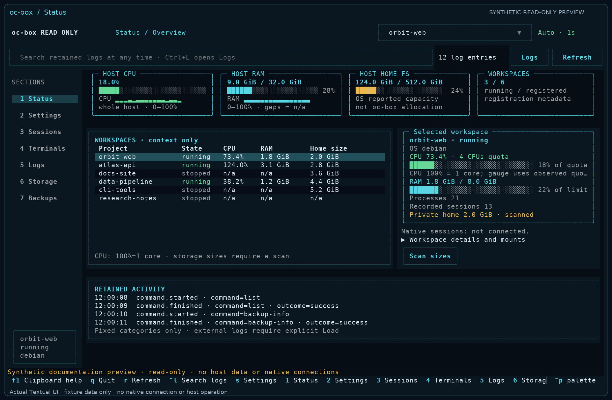
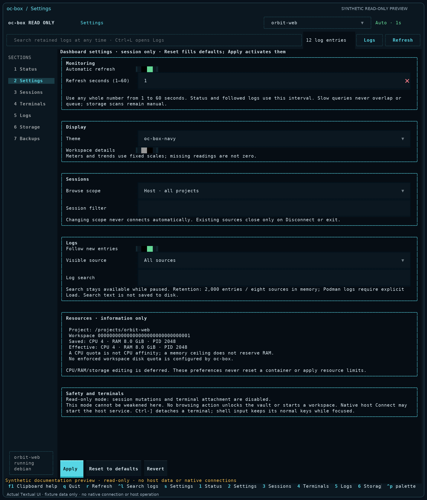
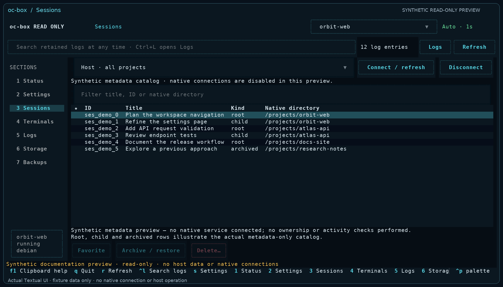
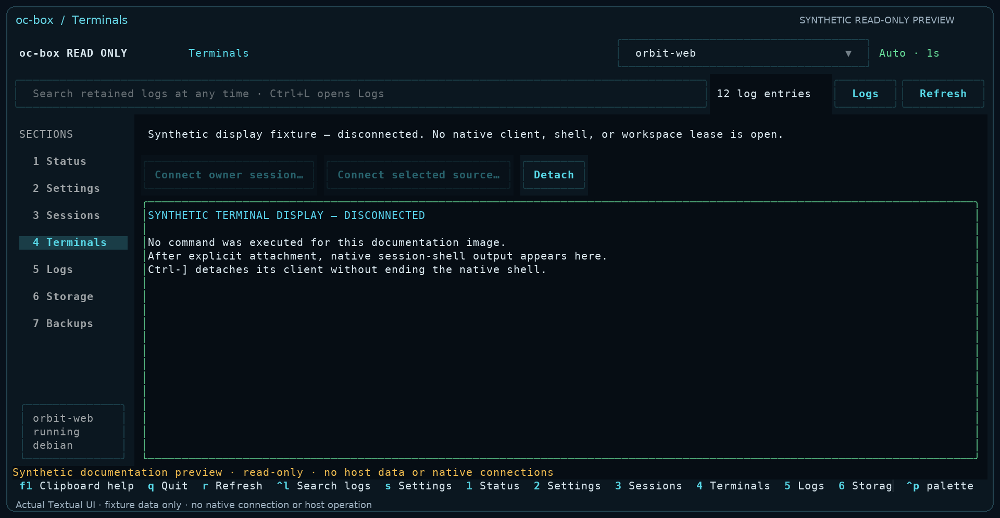
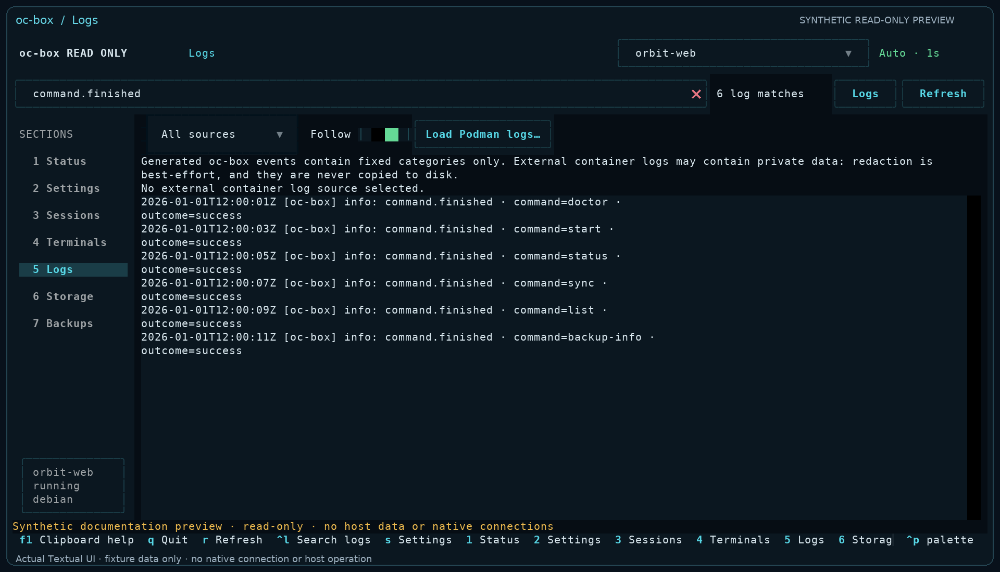
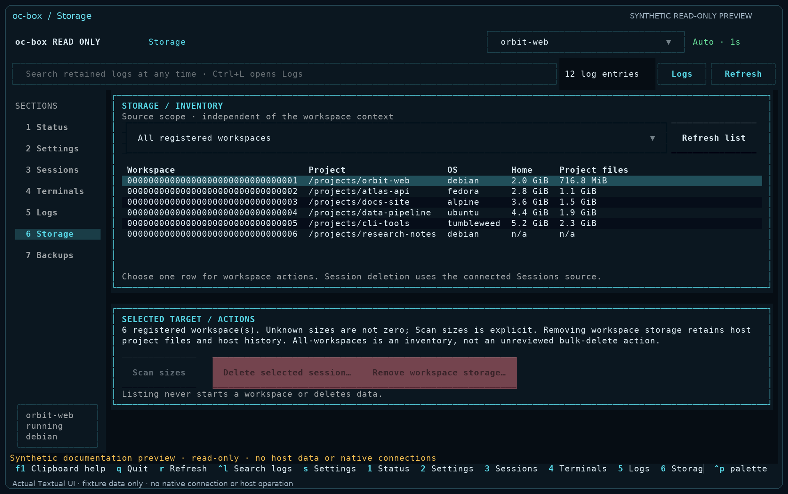
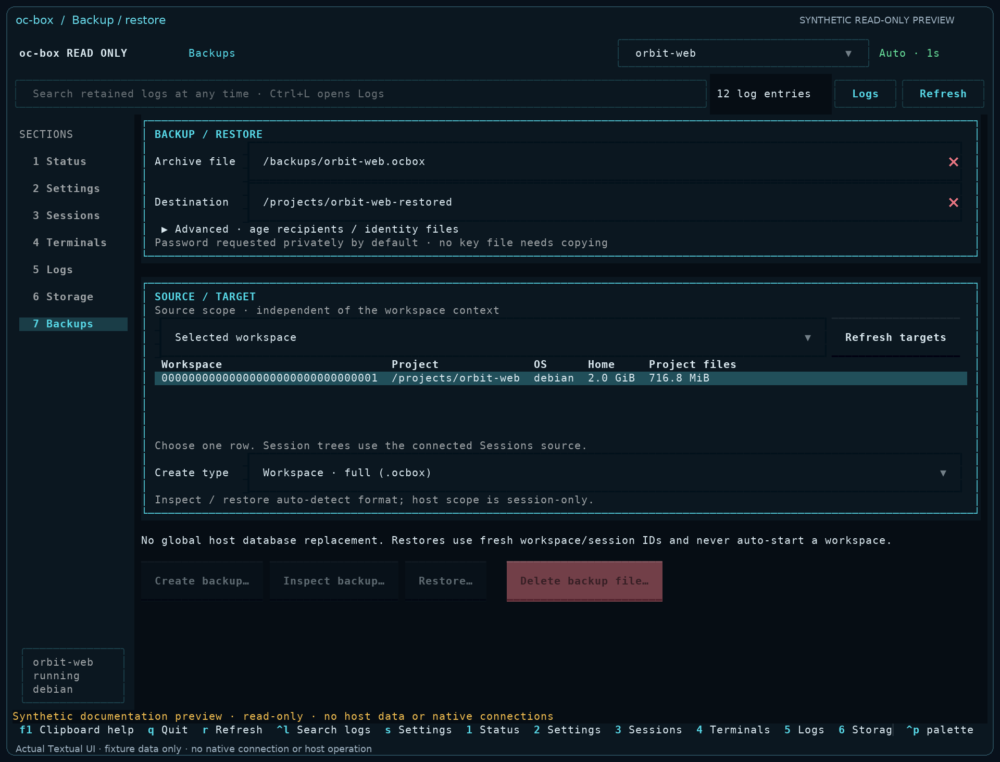

# Experimental workspace manager

> **OpenCode 2.x TUI guide.** Native session connections and persistent-shell
> integration here target 2.x workspaces. For legacy 1.x lifecycle and maintenance
> terminals, use the [legacy guide](legacy/README.md#workspaces-and-terminal).

[Documentation hub](README.md) · [Getting started](getting-started.md) ·
[Client guide](guides/clients.md)

**On this page**

| Task | Start here |
| --- | --- |
| Understand the experimental boundary | [Design and scope](#design-and-scope) · [Stable-release validation gate](#stable-release-validation-gate) |
| Install or restore dashboard dependencies | [Installation](#installation) · [Missing dependencies after a GitHub upgrade](#missing-tui-dependencies-after-a-github-upgrade) · [Card redesign availability](#card-redesign-availability) |
| Launch, navigate and use the clipboard | [Launch and navigation](#launch-and-navigation) · [Copying and pasting](#copying-and-pasting) |
| Find a dashboard section | [TUI guide](#tui-guide): [Status](#1-status), [Settings](#2-settings), [Sessions](#3-sessions), [Terminals](#4-terminals), [Logs](#5-logs), [Storage](#6-storage), [Backup/restore](#7-backuprestore) |
| Review private prompts and cancellation | [Paths and passwords](#paths-and-passwords) · [Progress and cancellation](#progress-and-cancellation) |

---

`oc-box tui` is an optional Textual dashboard for inspecting oc-box workspaces,
managing native OpenCode 2.x sessions, and attaching to their persistent session
terminals. It is separate from the native OpenCode conversation TUI opened by
`oc-box start`; it does not replace that client or add a new chat interface.

**Status: experimental development channel; incomplete UI acceptance is
explicitly disclosed, not passed.** The owner approved development publication,
not stable manager promotion. Stable 1.6.94 remains the default without this
manager. The embedded terminal remains experimental. The contract below
describes the integrated manager, not a completed test-execution report.
Check `oc-box tui --help` in the installed build for availability; previously
published packages need not include it. Demo/headless checks and native offline
fixtures do not establish interactive host or rootless-Podman acceptance.
See the [known acceptance limitations](releases/1.7.md#known-acceptance-limitations)
and [manager release notes](releases/tui-v1.md) for retained observations,
unfinished restore/storage checks and the separate stable-promotion gate.

## Design and scope

The compact tables, resource histories, and tabbed layout take visual inspiration
from [gputaskman](https://github.com/shanselman/gputaskman). oc-box uses Textual
with its own workspace/session integration; this is visual inspiration, not
copied gputaskman code or a claim of equivalent GPU monitoring.

The first manager is deliberately bounded:

- Inspect host/workspace status without starting a workspace.
- Show saved and effective settings without changing resource limits.
- Connect explicitly to native V2 session catalogs and keep sources distinct
  from independent host archive copies.
- Embed the existing native persistent-session terminal client rather than
  creating a replacement container shell.
- Keep log search available throughout the dashboard, not only while following
  new entries.
- Review one explicit workspace-storage removal or encrypted backup/restore
  operation, preserving normal lifecycle validators and native masked prompts.

**Live CPU/RAM limit edits, quotas and storage resizes remain deferred.** The
explicit reviewed removal/backup workflows below are not resource-limit edits.
There are no live resource edits, storage quotas, volume resizes, or
Podman graphroot/runroot moves here. The existing explicit CLI `reset` workflow
remains outside the dashboard; browsing never resets, syncs, starts, or unlocks
a workspace automatically. There is no `podman update` action or resource-edit
extension to the workspace owner's service.

## Installation

After a development package has been published, explicitly allow prereleases and
opt in to its dependencies through an isolated tool installation:

```sh
uv tool install --prerelease allow 'oc-box[tui]'
# Or:
pipx install --pip-args='--pre' 'oc-box[tui]'
```

To include the independent vault extra too, use `'oc-box[tui,vault]'`. For an
existing installation, use a launcher release supporting upgrade extras:

```sh
oc-box upgrade --devel --tui
# Or add both independent extras:
oc-box upgrade --devel --vault --tui
```

These commands work from stable or development. Verified uv/pipx owners receive
package-extra requests through their own manager, never the GitHub installer;
GitHub owners use the immutable private installer. Ambiguous plain-pip extras
or unrecognized/custom ownership receive manual guidance. Package automatic
updating remains off. Requests install dependencies only, not a credential policy,
vault initialization/unlock or dashboard launch.

For the channel-aware GitHub bootstrap:

```sh
sh install.sh --devel --with-tui
# Or enable both optional features:
sh install.sh --devel --with-vault --with-tui
```

Review the downloaded `install.sh` before running it. The equivalent piped
bootstrap suffix is `sh -s -- --devel --with-tui`, or
`sh -s -- --devel --with-vault --with-tui`. GitHub installations keep these optional
dependencies in the private immutable release, retain the opt-in across GitHub
updates, and leave running releases pinned to their original copy. No system or
user-site pip installation is needed. Normal non-TUI CLI operation retains its
stdlib-only baseline; the UI dependencies are optional, not prerequisites for
`start`, `status`, or recovery commands.

### Missing TUI dependencies after a GitHub upgrade

Selecting `oc-box upgrade --devel` alone does not request the TUI extra for the
first time. If `oc-box tui` reports “Optional TUI dependencies are missing”,
add it on the host as your regular user with a supporting launcher:

```sh
oc-box upgrade --devel --tui
oc-box tui
```

Add `--vault` only if you also want to request vault dependencies; an existing
opt-in is preserved without repeating it. The same selected release can gain
extras, and repeating a satisfied request is a no-op. Add `--check` to validate
support without installation or preference changes. Dependencies remain private
to the immutable GitHub release; no curl, workspace reset, history deletion or
system-Python installation is needed. Do not create a second pipx/uv copy.
An explicit TUI request against stable refuses; an inherited TUI preference is
retained for a later return to a supporting development target. See the
[channel-switch troubleshooting](update-channels.md#enable-the-dashboard-after-a-github-channel-switch).

These installation examples explicitly select experimental development;
stable 1.6.94 does not include the manager. Older channel-aware launchers must
upgrade normally to a published release supporting the extras flags first;
branch HEAD is not automatically published. Genuinely pre-channel 1.7 launchers
retain their exceptional bootstrap route; see
[update channels](update-channels.md#bootstrap-and-older-installations).
For ordinary unrelated projects, use the installed `oc-box tui` normally. The
self-checkout launch below is specifically for managing oc-box's own source.

The initial UI dependency ranges are `textual>=8.2.8,<9` and
`pyte>=0.8.2,<0.9`. These are optional dashboard dependencies, not replacements
for host Podman or OpenCode.

## Card redesign availability

The card layout and follow-up input/settings polish are integrated into `devel`
from `feature/tui-card-redesign` for a later publication. They are not automatically
included in an already-published development package. A source merge is not a
release or new interactive host acceptance; channel upgrades select published
releases, not branch HEAD.

## Launch and navigation

```sh
oc-box tui
oc-box tui --project ~/devel/demo
oc-box tui --workspace WORKSPACE_ID --read-only
oc-box tui --demo
```

Syntax:

```text
oc-box tui [--project PATH | --workspace ID] [--read-only] [--demo]
```

Run normal mode on the Linux host as your regular unprivileged user, with real
TTY input/output. A selector initially focuses the chosen existing
project/workspace; the header workspace picker permits switching registrations
from every section. It changes context only, never connects or starts a service.
Without one it offers the registered workspace overview.
Opening the manager does not create an environment or become its lifecycle
owner. `--read-only` disables session mutation, backup creation/restoration/deletion,
workspace removal and terminal control/input. Explicit encrypted-backup inspection
remains available. Read-only mode is
not a promise that an explicitly requested native host connection cannot start
the native host service.

For developing **oc-box inside its own workspace**, launch an isolated,
non-editable copy from the checkout:

```sh
uv run --no-project --with '.[tui]' python -I -m oc_box tui --project ~/src/oc-box
```

An editable launcher (`--with-editable`) executes trusted host code from that
same mounted project, so attachment correctly refuses it. This is the
`trusted-path-exposure` guard, not a missing owner or terminal failure. A normal
package keeps the launcher outside the mounted checkout; `python -I` also avoids
source-path overrides. Do not disable validation, reset the workspace or replace
its marker to work around an editable launch. Editable source remains suitable
for synthetic `--demo` and isolated tests.

`--demo` supplies fixed synthetic workspace metrics and logs; native session and
terminal connections are disabled. CPU/RAM/storage readings intentionally stay
the same after refresh. They are sample values, not measurements of the host.
Run normal host mode, optionally with `--read-only`, to see live measurements.
It permits a container preview, but never contacts host services, reads the real
workspace registry or host logs, or performs host/workspace actions. Synthetic
entries are not evidence of live connectivity or isolation. Normal mode does
not gain a container-mode bypass from the existence of demo mode.

| Key | Action |
| --- | --- |
| `1`–`5` | Status, Settings, Sessions, Terminals, Logs |
| `6`, `7` | Storage, Backup/restore |
| `r` | Refresh the current view |
| `s` or `F2` | Open all dashboard settings outside focused text inputs or the native shell |
| `Ctrl+L` | Open Logs and focus the log search |
| `q` | Quit outside a focused embedded terminal |
| `Ctrl-]` | Detach the focused session-terminal client |
| `Ctrl+Shift+C` | Copy selected text, when the terminal forwards this shortcut |
| `Ctrl+Shift+Y` | Copy the whole visible screen as plain text |
| `Ctrl+Shift+Insert` | Paste text copied inside the dashboard into the focused input or connected shell |
| `F1` | Explain clipboard shortcuts and host-terminal paste behavior |
| `Ctrl+A` / `Ctrl+Shift+A` in a text field | Select all field text and copy the completed selection |

When terminal input is focused, ordinary keystrokes belong to the shell rather
than dashboard shortcuts, including `s`, `F2` and the shell's `Ctrl+L`. The
always-visible header log search can still be clicked without ending the shell.
Detach with `Ctrl-]` first to use settings shortcuts, `Ctrl+L` and ordinary
dashboard keyboard navigation again. Settings shortcuts also leave focused text
inputs alone, and background refresh does not take focus from the native terminal.
The compact global header stays on one line and ellipsizes long
labels rather than crowding out controls on small terminals; log search remains
available from every tab.
Nonempty editable search and form fields show an **× inside their right edge**.
Click it to clear only that field and keep typing; it does not submit the form,
connect to a source or access the clipboard. Password and disabled fields do
not offer this control.
Session and log filters update after a short **120 ms typing pause**; text and
caret editing remain immediate. Unchanged views are not rebuilt, changed table
cells update in place where possible, and favorites are loaded outside the UI
thread. These reduce display work without lowering the monitoring cadence or
turning native session discovery into an automatic action.
Closing the dashboard disconnects only its clients and releases their leases;
it does not directly stop the workspace owner or end its native persistent shell.
If the owner was already waiting to exit, releasing its final client lease lets
normal sync/stop proceed; the shell does not survive a container stop.

### Copying and pasting

Drag to select visible text throughout the dashboard: diagnostics, tables,
logs, graphs, the embedded terminal and control labels. The highlight remains
visible over colored logs, row cursors and meters. **Releasing the mouse copies
the completed selection immediately**; no extra Copy click is required. A successful
copy shows a Clipboard notification. There are no Copy or Paste buttons. A label
drag never presses its button, changes its tab/dropdown, or activates a footer
shortcut. Normal clicks still operate those controls. Scrollbar drags still
scroll. Panel captions and settings group titles are selectable text as well.
Graph bars use `█`/`░` glyphs and histories use text sparklines, so their
plain-text copies are meaningful; clipboard text does not retain graph colors.

Completed double/triple-click text selections and explicit keyboard selection
in text fields (for example `Ctrl+A`, `Ctrl+Shift+A` or Shift+Arrow) also copy. There is no copy
while dragging, or from programmatic selection, focus, refresh or container
output. `Ctrl+Shift+C` (when forwarded by the host terminal) remains
available for an explicit repeat copy. Text fields retain their normal Textual
editing keys. In the native shell, ordinary `Ctrl+C` still interrupts and
`Ctrl+V` keeps its shell meaning; neither is replaced by a clipboard shortcut.
`Ctrl+A` selects all only in dashboard text fields; it retains its normal
start-of-line meaning in the focused native shell. A screen change or Escape
cancels an unfinished selection without copying or activating the old control.

**Copy view** (`Ctrl+Shift+Y`) copies the whole current visible screen as
plain text; it is not required for selecting control labels. The same shortcuts
work in ordinary settings and review dialogs without adding clipboard buttons.
`F1` explains them. Copying is available in read-only
mode and never confirms a dialog, changes a session, or starts a connection.
Table/log/terminal selections cover the displayed viewport, not offscreen
history. Scroll to the desired text before selecting. Followed-log display stays
in place while its text is highlighted; bounded collection continues in memory.

For text from your desktop clipboard, focus a text field or the connected shell
and use your **host terminal's paste command**—commonly `Ctrl+Shift+V`,
`Shift+Insert`, or its context menu. This delivers a normal terminal paste event.
The dashboard does not read the desktop clipboard in the background or install
clipboard helper programs.

**Paste copied** (`Ctrl+Shift+Insert`, shortcut only) instead pastes the last text copied
**inside this dashboard**, not arbitrary current desktop clipboard contents.
It targets only the focused, enabled text field or connected native terminal;
it never connects or starts a shell. Single-line fields use normal terminal-paste
semantics; the embedded terminal keeps its existing control filtering and
bracketed-paste framing. Its 64 KiB input bound includes UTF-8 bytes and framing,
and size/full-queue rejection sends no prefix of the rejected paste. A transport
failure can occur after partial delivery; its warning tells you to inspect the
shell rather than blindly retry a possibly partially executed command.

Host clipboard delivery uses Textual's OSC 52 support and depends on the terminal
and its clipboard permissions; it is not guaranteed in every terminal, remote
session or multiplexer. Copies are bounded to 1 MiB and remain only in
the app's clipboard memory and the user-requested host clipboard. The dashboard
never journals clipboard content or adds terminal recordings. Pasting into the
native shell is still normal shell input and may enter its existing native
session/shell history. Treat copied external logs/shell
output as sensitive. OSC clipboard requests emitted by container applications
remain stripped; only completed user selections or explicit dashboard copy
actions write to the host clipboard.

<a id="seven-sections"></a>

## TUI guide

<!-- tui-screenshot:about -->
The images below are generated from the **actual Textual interface**, using
synthetic in-memory workspaces, metrics and metadata. They are read-only/demo
captures: disabled action buttons are intentional, no native service is connected,
and no archive, credential, clipboard or host-workspace operation is performed.
They illustrate appearance, **not live monitoring or host acceptance**.
[Capture details and regeneration](assets/tui/README.md).
The images are repository/source-documentation assets; installed copies without
them can use the [online illustrated guide](https://github.com/groopcd/oc-box/blob/devel/docs/tui.md#tui-guide).

<!-- /tui-screenshot -->

Shortcuts `1`–`7` keep their existing order. Wide terminals use a left navigation
rail. Below 118 columns or 32 rows the rail becomes a section picker in the header, leaving
more cells for the working view. The workspace picker and literal log search stay
available across sections; the compact header occupies two rows.

The default `oc-box-navy` theme uses restrained cyan headings, green/amber
resource accents and thin card borders. Built-in Textual themes remain selectable
in Settings. The visual inspiration is the supplied terminal dashboard and
[gputaskman](https://github.com/shanselman/gputaskman), not its GPU/model telemetry.

### 1. Status

<!-- tui-screenshot:status -->


*Illustrative readings and storage sizes; unscanned/unknown values stay unknown.*

<!-- /tui-screenshot -->

Status presents shallow **Host CPU**, **Host RAM**, **Host Home FS** and
**Workspaces** cards, a workspace inventory and a **Selected workspace** inspector.
The table's CPU/RAM readings come from the existing report; private-home sizes
remain unknown until explicitly scanned. Running/registered counts are metadata,
not active native-session or job counts. The retained-activity card shows only
already-loaded `oc-box` journal categories, never external logs or agent calls.
No new telemetry collector is added.

Host cards combine into a compact resource strip at narrow widths. The inspector
folds beneath the table when entering compact layout; its title explicitly
expands it. A manually expanded inspector remains open when resizing within
compact mode. Terminals and Logs retain their useful cells instead of acquiring
decorative resource cards. Short in-memory CPU/RAM
histories use a fixed 0–100% scale, not an auto-scaled sparkline that exaggerates
small changes. Full workspace details and mount information remain available in
an expandable section, initially collapsed; the Settings display controls can
change its visibility.

Workspace CPU's numeric percentage keeps the convention **100% = one CPU core**
and can exceed 100%. Its meter uses the observed CPU quota as capacity when that
quota is known; normalized meter/history values do not replace the numeric
reading. Unavailable or unlimited capacity is identified as such, never invented
as zero. Other unavailable readings are also shown as unavailable. System values
are what the OS reports, not a promise of exclusive resources or physical host
capacity. Presentation does not change underlying totals or the raw report data.

Cheap metrics are batched. Status and followed logs share an adjustable refresh
interval of **any whole number from 1 to 60 seconds**, default **1 second**, with an
auto-refresh control. Cadence is best-effort: a slow query does not overlap or
queue another refresh, so the selected interval is not an exact timing guarantee.
Native session inventories still require explicit Connect and manual refresh.
With no current workspace, System readings and monitoring settings remain
available; missing workspace data does not become a zero-valued workspace.

Allocated project/home/container storage scans are a separate explicit action
for the selected workspace, not part of every refresh. They can be expensive and
remain estimates:
reflinks, compression, shared image layers and filesystem accounting do not
establish exclusive physical consumption or quota headroom. Reading a mount or
filesystem capacity does not authorize changing it. See the
[resource report reference](cli.md#resource-reports).

### 2. Settings

<!-- tui-screenshot:settings -->


*Expanded-height capture of all six settings groups, with Apply, Reset and Revert.*

<!-- /tui-screenshot -->

All dashboard preferences appear directly in the Settings tab, not a separate
window. `2`, `s` or `F2` navigates there using the normal section navigation;
shortcuts apply only outside focused text inputs and the native shell.
The categorized inline form is also usable without a current workspace:

| Topic | Controls and boundaries |
| --- | --- |
| Monitoring | Auto-refresh and a custom shared Status/followed-log interval: any whole number from 1 to 60 seconds; default 1. |
| Display | Built-in Textual theme and expanded/collapsed diagnostics details. |
| Sessions | Scope and text filter only; changing them never connects or refreshes a native inventory automatically. |
| Logs | Follow, source and literal search; searches stay in memory and are never persisted or journaled. External sources retain their explicit opt-in and ownership guards. |
| Resources | Read-only saved limits and observed values. |
| Safety/terminals | Read-only information about the CLI-selected mode and terminal safety; the `--read-only` fence cannot be weakened here. |

**Reset to defaults** stages factory dashboard preferences without immediately
changing the active dashboard. Defaults are automatic
one-second refresh, `oc-box-navy`, collapsed details, global session scope,
following all loaded log sources, and empty session/log filters. **Apply** makes
them active; **Escape** or **Revert** discards the reset. No reset touches containers,
resource limits, history, favorites or retained log entries, and it cannot weaken
the CLI-selected read-only mode.

**Escape** or **Revert** discards pending form edits. **Apply** accepts only the
allowlisted dashboard preferences, for **this dashboard session only**. Changes
are neither persisted nor logged; they do not modify OpenCode `cli.json`, host
settings, workspace resources or credential snapshots. There are no CPU/RAM/
storage edit controls, resource-control RPCs, implicit resets or storage
migrations. A settings Apply is not a resource Apply or native service reload.

Enter refresh seconds directly in the Monitoring field. Blank, fractional or
out-of-range values show inline feedback and do not apply any other draft
preferences. Unapplied changes do not alter monitoring cadence. Drafts survive
tab changes, background refreshes and workspace selection; resource information
updates separately. There is only one monitoring form, not duplicate quick
controls. Settings and Logs Follow use compact single-row native switches,
retaining click/Space operation, spatial on/off state and visible keyboard focus.

If you deliberately need different create-time limits, exit the relevant
clients/owner and use the existing CLI workflow outside the manager:

```sh
oc-box reset --project ~/devel/demo --cpus 8 --memory 16g
```

That command recreates the container OS; it is not a live resize. Review the
[reset reference](cli.md#reset) first. Native config hot reload does not require
restarting the host service and does not import new vault values or host config
into a running workspace.

### 3. Sessions

<!-- tui-screenshot:sessions -->


*Synthetic catalog only: no native connection, lease, ownership or activity check.*

<!-- /tui-screenshot -->

Session discovery is an explicit **Connect**, followed by manual refresh. Merely
visiting the tab never discovers/starts a service or synchronizes archives.
**Disconnect** sits beside **Connect / refresh** in the source toolbar, including
on compact terminals. It retains the existing cancellation/lease-release behavior.
Choose the connection before interpreting a selected session:

The table is a static snapshot between explicit operations. Background status,
log-follow and storage updates do not rebuild its rows or reset the cursor or
scroll position. Use **Connect / refresh**, or `r` while the connected Sessions
tab is active, to fetch new entries. Editing a filter, selecting a project or
performing a session action updates the relevant view on demand.

| Connection | Scope and side effects |
| --- | --- |
| Host global | The complete paginated native V2 inventory across projects, including children and archived sessions. Explicit Connect uses normal native CLI discovery and **may start the native host service**. |
| Host project | Native project sessions plus controller-directory archive associations only where their oc-box provenance can be verified. An archive title alone is not verification. |
| Existing V2 workspace | The already-running private workspace service, through an explicit client lease. No owning start, vault unlock, or credential refresh; never redirect it to the host service. |

An incomplete/invalid inventory is not a complete list or evidence that missing
sessions were deleted. A same-looking session ID or title in another store does
not authorize a mutation there. Disconnect releases the workspace client lease;
while connected, that lease can keep an exiting workspace owner waiting before
its final sync/stop. The lease remains held until Disconnect or dashboard exit;
the dashboard makes this owner-wait effect visible. A host connection is
independent of workspace services.

Favorites are private dashboard state, keyed by source/store/session identity.
They are not native OpenCode pins and do not modify native pin APIs or
transcripts.

Native V2 **archive/unarchive** changes only the selected native session's archive
state; it is not oc-box history export or a recursive archive operation. Archived
workspace roots remain in history synchronization but are not automatic resume
targets. Archive and resume selection therefore need checking separately.

**Delete** is a guarded native recursive deletion. Deleting a parent includes
its native descendants, even when they are outside the current project filter;
the preview lists the affected native IDs and directories. Inspect the selected
source/store and full cascade, then type `DELETE` to confirm. The dashboard
refuses cascades larger than **50 sessions**, including the selected parent,
rather than presenting an incomplete review. A managed host archive with native
children is refused, not treated as an ordinary recursive-delete target.
There is no bulk-delete operation. The manager refuses mutations when
activity/ownership cannot be established or work is active or unconsumed. It
does not abort work to make deletion possible.

Native activity checks describe the connected server process, not all processes
that might access host history. A process-local connection carries a race
warning: another host client can change a session after validation and before
mutation. These guards are not a cross-process transaction or a guarantee that
recursive deletion cannot race.

Archiving never implicitly closes a running persistent shell. Deletion refuses
running terminals in its cascade, including idle shells, until they exit.
The initial inventory can be cancelled by Disconnect or exit; cancellation is
checked between pages, and its pending lease releases after the current bounded
native request. A late mutation result cannot restore a disconnected/replaced
source's rows.

The workspace source and its host archive are independent copies. Deleting or
archiving a host copy does not delete/archive the workspace source; changing a
source does not instantly update its mirror. Later normal oc-box sync may
replace a managed host copy or recreate a deleted one from a still-present
source. This manager adds no permanent mirror suppression or bidirectional
editing. Existing [sync and recovery rules](cli.md#sync) still apply.

OpenCode 1.x remains supported by the existing launcher/CLI. The new live session
manager APIs are V2-only; this guide makes no native V1 archive/unarchive claim.

### 4. Terminals

<!-- tui-screenshot:terminals -->


*Disconnected display fixture, not shell output; no terminal process was started.*

<!-- /tui-screenshot -->

The embedded view uses an optional `pyte` terminal emulator around a **local PTY
running the existing native persistent-session terminal client**. It is not a
new `podman exec` shell, a maintenance shell, or a mini chat interface. Terminal
creation or taking interactive control requires an explicit confirmation; a
read-only view does not authorize shell input.

Before attachment, the selected source session must be verified as a member of
the connected native store/workspace. A foreign session or independent host
archive copy is not authority to attach to a workspace shell. A live private V2
workspace owner is required for its session terminals; browsing never starts it.

The native PTY owns shell state. `Ctrl-]` detaches the local client but leaves
the native shell available for reattachment. Typing `exit` in that shell ends
it. Dashboard resize is forwarded through the existing client; TUI/web clients
may regain interactive control independently. Closing the dashboard releases
its leases, not the owner or other clients. See the
[native terminal reference](cli.md#terminal) for the existing client boundary.

The emulator is not a complete xterm implementation. Native application mouse reporting, images,
complex grapheme rendering and extended keyboard protocols are not supported;
use the native standalone terminal client for applications needing those
capabilities.

Retained operator observations cover bounded embedded rendering/input,
focus/resize and native PTY behavior with their original
`NOT_AUTOMATICALLY_PASSED` qualification. They are not a completed dashboard
acceptance block. Headless emulator output and earlier native terminal tests
cannot supply missing observations or establish lease cleanup after an
unconfirmed manager Quit.

### 5. Logs

<!-- tui-screenshot:logs -->


*Fixed activity examples; no external container logs were loaded.*

<!-- /tui-screenshot -->

The case-insensitive **literal** log search stays visible across all seven tabs.
`Ctrl+L` opens Logs and focuses it. Search applies to retained entries and can be
changed at any time, including while follow is paused. Source filtering and
follow/pause controls never disable search; it is not a regular-expression or
shell-command field. Follow uses the same best-effort refresh interval as Status
(default one second); pausing follow leaves retained entries searchable. Search
text and settings changes are never saved or written to the activity journal.

The header shows **N log entries** when search is empty and **N log matches**
when filtering, with singular forms for one result. These are retained log
entries visible in the selected Logs source, not sessions, workspaces or agent
calls.
Hover for an explanation. The double-width red **❌**, with a two-cell click
target, clears only the input/filter,
restoring the unfiltered count rather than deleting logs. Search feedback stays
current while a selected output snapshot is held still for copying.

The default oc-box activity source is the private rotating JSON-lines journal
`log/activity.jsonl` under the configured oc-box state root:
`OC_BOX_STATE_HOME`, otherwise `$XDG_STATE_HOME/oc-box`. With neither override,
the file is `~/.local/state/oc-box/log/activity.jsonl`. Rotations are
`activity.jsonl.1` through `activity.jsonl.3`: four files capped at 256 KiB each.
Files use mode 0600 and private directories 0700; readers never create journal
files.

The dashboard's oc-box source shares validated severity and message formatting
with the read-only host command [`oc-box logs`](cli.md#logs). The dashboard
shows all retained levels, including `debug`; only the CLI defaults to `info`
or higher. Valid older entries without a severity remain readable with a
derived level. Missing or unsafe journal data is treated as empty.

Entries contain fixed event categories and allowlisted metadata. Reason codes
and metric names come from fixed lists, and metric values are bounded integers.
Entries contain **no raw arguments, environment values, errors, stdout/stderr,
prompts, conversation transcripts, pairing links, authentication or clipboard
data, or other free-form text**. The UI retains at most 2000 log entries globally
and displays at most 1000 generated-journal entries per refresh. The journal is
not a terminal recording, a native OpenCode logfile or a permanent audit archive.
Demo mode reads none of these files.

**Podman container logs are a separate, explicit opt-in source.** Only a selected
verified oc-box-owned container may be queried: `--tail` 500 lines, a 1 MiB byte
cap and a 10-second timeout. The dashboard keeps retrieved content in memory
only; it never appends it to the oc-box activity journal. Common credential
patterns are redacted on a best-effort basis, **not proof that arbitrary secrets
have been removed**.
Container output can contain private text or unrecognized credentials. Treat
that display as sensitive; do not share screenshots or terminal recordings
without your own review. Opting in is not permission to read unrelated
containers or unlimited historical output.

### 6. Storage

<!-- tui-screenshot:storage -->


*Metadata fixtures only: no storage scan, deletion or workspace removal took place.*

<!-- /tui-screenshot -->

Choose **Host OpenCode**, **Selected workspace**, or **All registered workspaces**.
These are different scopes, not aliases for a database or filesystem directory.
Host storage management is limited to individual session trees selected through
the verified Sessions connection. It never offers a whole-host database wipe.
Selected/all workspace lists read bounded registration metadata without starting
services or workspaces. All-workspaces offers individual targets, not a bulk wipe.
Sizes remain unknown until a manual scan; shared/reflink accounting is not
exclusive physical usage or quota headroom.

**Remove workspace storage** reviews one canonical workspace ID, registry and
project identity. Type the full workspace-specific confirmation. The same pinned
runtime then uses normal CLI purge checks and its exclusive lock. Existing owners
and attached clients must exit first; no forced shutdown or lock bypass is added.
Plain purge can briefly start the existing container for final history sync.
Project files, host conversations and verified archive recovery provenance are
retained; the UI never adds the project/history deletion flags. It does not prune
shared images, caches, global vaults or retired provenance.

**Delete selected session** reuses the Sessions cascade/activity/ownership review
for the chosen source. Host archive copies are not workspace-source deletion
targets, and a source switch cannot redirect a previously reviewed action.

### 7. Backup/restore

<!-- tui-screenshot:backups -->


*Example paths, not real archives; no backup was created, inspected or restored.*

<!-- /tui-screenshot -->

The three scopes remain explicit here. Choose one workspace from the selected/all
inventory for a full or portable encrypted `.ocbox` backup. The ordinary
[backup/restore contract](cli.md#backup) remains authoritative:
no overwrite, no in-place restore, fresh workspace/resource IDs, private rootless
ownership transport, no privilege reactivation, and stopped restored workspaces.
Whole-workspace archives can contain copied config/auth and native history, but
exclude the global host vault and normal host database. Protect the encrypted file.

For host or workspace **session-tree history**, select that verified native source
and root in Sessions, then choose the `.ocsession` kind. This is not a storage or
process checkpoint. The encrypted version-1 envelope has exactly `key.age`,
`manifest.age` and `sessions.age`; only ciphertext is staged on disk. Limits are
50 sessions, 100,000 messages and 64 MiB encoded history. Complete inventories,
quiet source ownership and checked native exports are required; process-local
checks do not eliminate races with other host processes.

Session restore decrypts and validates before an additional metadata-only review
inside the dashboard, retaining its plan and native connection in the same child.
Click **Restore reviewed data**, or focus it and press Space, to approve the
fresh IDs shown. Enter is intentionally ignored so queued password submission
cannot approve the next review. Permissions and privileged configuration are cleared; parent links
refer only to newly restored sessions. Existing history is not overwritten and
restored work is not run. Native import success alone is not accepted: history
and inventory are verified afterward. A partial failure reports observed new and
attempted IDs for explicit recovery, not an atomic rollback or automatic delete.

### Paths and passwords

The archive path is the primary field. A blank workspace restore destination
gets a visible, editable, absent sibling suggestion; displaying a suggestion
creates nothing. Inspect/restore route from bounded envelope structure, not the
filename suffix. Authentication failure never tries another engine or native
store. Choose full/portable for creation; host scope creates one selected native
session tree, not a whole-host backup.

Age recipients and existing private identity-file paths are optional **Advanced**
controls, initially collapsed. Ordinary password backups require no manual key
copying: a fresh per-archive identity is generated in anonymous memory and stored
encrypted in the archive. Choose a password and keep it safely; oc-box does not
save it and cannot recover it. The provider vault is neither reused as a backup
password nor included in a workspace archive.

Create, inspect and restore stay in an operation modal. Password input is a
custom masked, nonselectable editor, not Textual Input or ClipboardInput; it
submits completed input only to the existing child's private controlling TTY.
No reveal, automatic clipboard read, copied-text cache, search or clear-X action
is available there. Explicit terminal paste remains bounded and single-line.
Password confirmation starts empty and unfocused: click its box or Shift+Tab
before typing. A lost password is not an automatic key-management problem that
the dashboard silently resolves.

The manager's transient private editor is part of the secret-memory trust
boundary. Core dumps are disabled before private input, but Python memory
erasure, same-user debugger, swap or terminal-recording protection is not
guaranteed. Passwords are never stored as widget values/reactives/messages,
protocol metadata, argv/env, plaintext files, clipboard content or journal
entries. Private operations refuse Textual debugging, developer tools and
event-file logging because those facilities can record input before widget
handlers. Global copy/paste, help, palette and navigation are fenced through
child exit, including gaps between dialogs; local focus traversal remains usable.

### Progress and cancellation

The modal shows **named stage + elapsed seconds + an indeterminate progress bar**.
It does not estimate a byte/time percentage, scan extra data to manufacture a
total, display raw child output or write a terminal transcript to Logs. Inspection
shows a bounded metadata projection rather than arbitrary private manifest data.

Cancel or Ctrl+C requests the operation child's normal cleanup. The dashboard
waits for actual exit and verified completion before releasing its busy state.
There is no forced operation kill, automatic retry or rollback. Backup's existing
stop-before-password ordering is unchanged: cancellation can leave an unowned
source container stopped. Partial session imports retain attempted versus
observed fresh IDs, including cancellation after submission. Inspect the explicit
target before retrying an unverified outcome. A cancellation after completion
was already verified is identified as such, not reported as an accepted cancel.

Ordinary CLI password prompts remain unchanged. Storage removal and encrypted
file deletion retain their separate foreground handoff and destructive typed
review.

**Inspect backup** is explicit and available in CLI read-only mode. **Delete backup
file** is a distinct typed operation on one owned, private, regular supported
encrypted archive; deleting it does not remove any live session or storage.
Cancel, stale selection and read-only checks apply again at execution time.
Backup file paths and decrypted transcript text never enter the activity journal.

## Stable-release validation gate

The development release is explicitly experimental. A full UI restore returned
0, but its later integrity verifier refused `manifest`; full restored integrity
remains unaccepted. The intentional extraction-root mode change 0755 to 0700
does not prove all-entry equality or the sole failure cause. Portable UI was not
armed; remaining three-scope Storage, designated ciphertext deletion,
source-removal preservation, final journal/attestation and manager Quit checks
were not completed. See the [complete limitations](releases/1.7.md#known-acceptance-limitations).

The separate six-stage CLI V1/V2 lifecycle gate **is complete** on `5573965`
with native 1.19.5/2.2.6. It is not a completed UI gate and is not to be replayed
for documentation. Prior source-qualified results are not exact-source passes
for the channel-integrated successor.

This document describes the manager contract, not completed stable acceptance.
Its bounded implementation/validation layers are:

1. Transport-free session domain, private favorites and fixed-category logging.
2. Optional installation, seven-tab UI, cheap metrics and synthetic-only demo.
3. Explicit native host/workspace connections and guarded V2 session actions.
4. Existing-client PTY embedding, interactive behavior and lease cleanup.
5. Reviewed storage deletion and encrypted workspace/session backup/restore,
   including private in-dashboard TTY-backed prompts, progress and privacy-safe
   failure notifications.
6. Clean-candidate host acceptance and review before any stable publication.

Each integrated layer needs behavior-focused tests; declaring a phase does not
mark it passed. See the [manager test plan](testing.md#experimental-workspace-manager)
and [publication checklist](../CONTRIBUTING.md#release-gate-and-publication-checklist).
Keep the tested full commit, clean/dirty state, native executable identities and
manual observations with the evidence. Existing stable host reports validate
their own earlier source and scope, not this new dashboard. No resource-editing
phase is included: CPU/RAM limit edits, quotas, resizes and store moves remain
separate work.

The approved development publication belongs on `devel` as a GitHub prerelease
and `.dev0` PyPI version after relevant new-source CI/package/build-only checks.
Do not advance `master`, create a stable tag or publish a final PyPI version by
treating that approval as stable acceptance. Stable promotion requires complete
manager acceptance, applicable final-source gates and separate approval; this is
not an instruction to reopen stopped fixtures. A build artifact, demo or prior
native conversation-TUI pass is not the missing host evidence.
